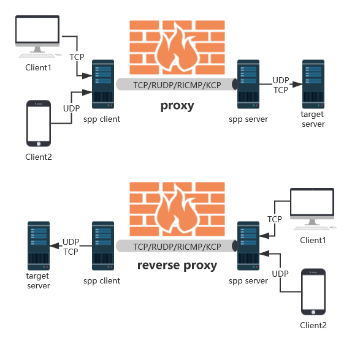

# SPP (Simple & Powerful Proxy)

[](https://github.com/esrrhs/spp)
[](https://github.com/esrrhs/spp)
[](https://github.com/esrrhs/spp/releases)
[](https://github.com/esrrhs/spp/releases)
[](https://hub.docker.com/repository/docker/esrrhs/spp)
[](https://github.com/esrrhs/spp/actions)
[](https://codecov.io/gh/esrrhs/spp)

SPP is a versatile, high-performance network proxy and traffic-forwarding tool written in Go.

> **Disclaimer**: This tool is intended exclusively for academic, research, and authorized testing purposes. Do not use it for unauthorized or illegal activities.



---

## Table of Contents

- [Features](#features)
- [Installation](#installation)
- [Quick Start](#quick-start)
  - [1. Automatic Configuration Generator (Recommended)](#1-automatic-configuration-generator-recommended)
  - [2. Command-Line Usage](#2-command-line-usage)
- [Proxy Modes & Examples](#proxy-modes--examples)
  - [Port Forwarding (Forward Proxy)](#port-forwarding-forward-proxy)
  - [NAT Traversal / Intranet Penetration (Reverse Proxy)](#nat-traversal--intranet-penetration-reverse-proxy)
  - [SOCKS5 Proxy (Forward & Reverse)](#socks5-proxy-forward--reverse)
  - [HTTP / HTTPS Proxy (Forward & Reverse)](#http--https-proxy-forward--reverse)
  - [Cross-Protocol Tunneling (QUIC / KCP / RUDP / RICMP)](#cross-protocol-tunneling-quic--kcp--rudp--ricmp)
- [Configuration Files](#configuration-files)
- [Performance & Benchmark](#performance--benchmark)
- [Health Check & Monitoring](#health-check--monitoring)
- [Ecosystem & Plugins](#ecosystem--plugins)
- [Documentation](#documentation)
- [License](#license)

---

## Features

- **Multi-Protocol Transit**: Supports establishing tunnel connections over `TCP`, `UDP`, `RUDP` (Reliable UDP), `RICMP` (Reliable ICMP ping tunnel), `RHTTP` (Reliable HTTP), `KCP`, and `QUIC`.
- **Protocol Multiplexing & Conversion**: Transparently tunnel `TCP` or `UDP` traffic through any supported reliable transit protocol across network boundaries. Multiple forwarding rules share a single multiplexed transit tunnel.
- **Versatile Proxy Topologies**:
  - **Forward Proxy**: Expose remote services on a local port.
  - **Reverse Proxy**: Expose local services behind NATs/firewalls to the public server.
  - **SOCKS5 Proxy**: Standard SOCKS5 proxy supporting both TCP streaming and UDP relay (`UDP ASSOCIATE`), with optional username/password authentication.
  - **Reverse SOCKS5 Proxy**: Turn the public server into a SOCKS5 entrypoint routing out through the client network.
  - **HTTP/HTTPS Proxy**: Full HTTP proxy supporting standard HTTP methods and HTTPS tunneling (`CONNECT`), with optional Basic authentication.
  - **Reverse HTTP/HTTPS Proxy**: Provide an HTTP/HTTPS proxy endpoint on the public server backed by the client.
  - **Shadowsocks SIP003 Plugin**: Pluggable transport support via [spp-shadowsocks-plugin](https://github.com/esrrhs/spp-shadowsocks-plugin).
- **Strong Security**:
  - HMAC-SHA256 challenge-response handshake (`-key`); credentials are never transmitted in plaintext.
  - Full-payload AEAD wire encryption (`-encrypt`) using `ChaCha20-Poly1305` or `AES-GCM`.
  - Strict key requirement: no insecure default passwords.
- **High Performance & Low Latency**:
  - High-throughput streaming with configurable `zstd` (default) or `zlib` compression.
  - Multi-queue priority scheduling ensuring low-latency delivery of control and handshake frames.
  - Zero-cost log bypass mode (`-nolog 1 -noprint 1`) for extreme throughput environments.
- **Operational Reliability**:
  - Health probe endpoints (`/healthz` and `/status` via `-statusaddr`).
  - Active keepalive ping monitoring and auto-reconnection.
  - Graceful shutdown on standard OS termination signals.

---

## Installation

### Precompiled Binaries

Download ready-to-use binaries for Linux, macOS, and Windows from the [Releases](https://github.com/esrrhs/spp/releases) page.

### Build from Source

Requirements: Go 1.20 or newer.

```bash
git clone https://github.com/esrrhs/spp.git
cd spp
go build -o spp .
```

### Docker

SPP provides an official container image:

```bash
# Pull image
docker pull esrrhs/spp:latest

# Run SPP server with host networking
docker run -d --name spp-server --net=host esrrhs/spp \
  -type server -proto tcp -listen :8888 -key "your-auth-key" -encrypt "your-encrypt-key"
```

---

## Quick Start

### 1. Automatic Configuration Generator (Recommended)

Generate an all-protocol server configuration alongside ready-to-use client templates with a single command:

```bash
./spp -genconfig
# Or generate into a dedicated directory:
./spp -genconfig -outdir ./conf -force
```

This generates paired configurations pre-populated with matching secure random keys:
- `config_server.json`: Preconfigured with multi-protocol listeners (`tcp`, `rudp`, `ricmp`, `kcp`, `quic`, `rhttp`).
- `config_proxy_client.json`: Forward port proxy client.
- `config_reverse_proxy_client.json`: Reverse port proxy client.
- `config_socks5_client.json`: Local SOCKS5 proxy client.
- `config_reverse_socks5_client.json`: Reverse SOCKS5 proxy client.
- `config_http_client.json`: Local HTTP/HTTPS proxy client.
- `config_reverse_http_client.json`: Reverse HTTP/HTTPS proxy client.

Start the instances:
```bash
# Run server
./spp -config config_server.json

# Run desired client (e.g., SOCKS5)
./spp -config config_socks5_client.json
```

---

### 2. Command-Line Usage

Both endpoints must use matching `-key` (authentication) and `-encrypt` (wire encryption) flags.

#### 1. Start Server
Listen on TCP port 8888:
```bash
./spp -type server -proto tcp -listen :8888 \
  -key "your-auth-key" -encrypt "your-encrypt-key"
```

The server can also listen on multiple protocols and ports simultaneously:
```bash
./spp -type server \
  -proto tcp -listen :8888 \
  -proto rudp -listen :9999 \
  -proto quic -listen :4433 \
  -key "your-auth-key" -encrypt "your-encrypt-key"
```

---

## Proxy Modes & Examples

### Port Forwarding (Forward Proxy)

Forward a local port through the SPP server to a target destination:

```bash
# Forward local port 8080 to target remote 8080 over TCP
./spp -type proxy_client -server www.server.com:8888 \
  -fromaddr :8080 -toaddr :8080 -proxyproto tcp \
  -key "your-auth-key" -encrypt "your-encrypt-key"
```

*Forward multiple ports (TCP + UDP) over one tunnel:*
```bash
./spp -type proxy_client -server www.server.com:8888 \
  -fromaddr :8080 -toaddr :8080 -proxyproto tcp \
  -fromaddr :9000 -toaddr :9000 -proxyproto udp \
  -key "your-auth-key" -encrypt "your-encrypt-key"
```

### NAT Traversal / Intranet Penetration (Reverse Proxy)

Expose a local internal service to visitors reaching the public SPP server:

```bash
# External clients accessing server:8080 are routed to local service on 8080
./spp -type reverse_proxy_client -server www.server.com:8888 \
  -fromaddr :8080 -toaddr :8080 -proxyproto tcp \
  -key "your-auth-key" -encrypt "your-encrypt-key"
```

### SOCKS5 Proxy (Forward & Reverse)

#### Local SOCKS5 Proxy
Start a SOCKS5 proxy on local port `1080` forwarding outbound requests via the server (supports TCP and UDP relay):
```bash
./spp -type socks5_client -server www.server.com:8888 \
  -fromaddr :1080 -proxyproto tcp \
  -key "your-auth-key" -encrypt "your-encrypt-key"
```

*With authentication:*
```bash
./spp -type socks5_client -server www.server.com:8888 \
  -fromaddr :1080 -proxyproto tcp \
  -username "admin" -password "secret" \
  -key "your-auth-key" -encrypt "your-encrypt-key"
```

#### Reverse SOCKS5 Proxy
Open a SOCKS5 entrypoint on the public server (e.g. port `1080`), egressing through the client's internal network:
```bash
./spp -type reverse_socks5_client -server www.server.com:8888 \
  -fromaddr :1080 -proxyproto tcp \
  -key "your-auth-key" -encrypt "your-encrypt-key"
```

### HTTP / HTTPS Proxy (Forward & Reverse)

#### Local HTTP/HTTPS Proxy
Spawn an HTTP proxy on local port `8080` (supporting standard HTTP and HTTPS `CONNECT` tunnels):
```bash
./spp -type http_client -server www.server.com:8888 \
  -fromaddr :8080 -proxyproto tcp \
  -key "your-auth-key" -encrypt "your-encrypt-key"
```

*With Basic Auth:*
```bash
./spp -type http_client -server www.server.com:8888 \
  -fromaddr :8080 -proxyproto tcp \
  -username "admin" -password "secret" \
  -key "your-auth-key" -encrypt "your-encrypt-key"
```

#### Reverse HTTP/HTTPS Proxy
Open an HTTP proxy port on the public server that tunnels traffic out through the client network:
```bash
./spp -type reverse_http_client -server www.server.com:8888 \
  -fromaddr :8080 -proxyproto tcp \
  -key "your-auth-key" -encrypt "your-encrypt-key"
```

### Cross-Protocol Tunneling (QUIC / KCP / RUDP / RICMP)

SPP allows wrapping application traffic (`proxyproto`) inside any supported transit protocol (`proto`).

- **Tunnel over QUIC:**
  ```bash
  ./spp -type proxy_client -proto quic -server www.server.com:4433 \
    -fromaddr :8080 -toaddr :8080 -proxyproto tcp \
    -key "your-auth-key" -encrypt "your-encrypt-key"
  ```

- **Tunnel over KCP with Reed-Solomon FEC:**
  ```bash
  # Client side with 10 data shards and 3 parity shards
  ./spp -type socks5_client -proto kcp -server www.server.com:8888 \
    -kcpfecdata 10 -kcpfecparity 3 \
    -fromaddr :1080 -proxyproto tcp \
    -key "your-auth-key" -encrypt "your-encrypt-key"
  ```

- **Tunnel over ICMP Echo Ping (RICMP, bypasses TCP/UDP blocking):**
  ```bash
  # Server listening on ICMP (requires root/CAP_NET_RAW)
  ./spp -type server -proto ricmp -listen 0.0.0.0 -key "your-key" -encrypt "your-key"

  # Client connecting via ICMP
  ./spp -type socks5_client -proto ricmp -server www.server.com \
    -fromaddr :1080 -proxyproto tcp -key "your-key" -encrypt "your-key"
  ```

---

## Configuration Files

Instead of lengthy CLI commands, manage configurations with JSON files:

```json
{
  "type": "socks5_client",
  "server": "1.2.3.4:8888",
  "proto": ["tcp"],
  "proxyproto": ["tcp"],
  "fromaddr": [":1080"],
  "key": "your-auth-key",
  "encrypt": "your-encrypt-key",
  "encrypttype": "chacha20",
  "compress": 128,
  "compresstype": "zstd"
}
```

Load the configuration file:
```bash
./spp -config client.json
```

---

## Performance & Benchmark

Maximum single-machine bandwidth testing with TCP proxy over various transit protocols (tested via `iperf`):

| Protocol Combination | Speed (Direct) | Speed (Encrypted) | Speed (Encrypted + Compressed) |
| :--- | :--- | :--- | :--- |
| **Direct Connection** | 3535 MB/s | — | — |
| **TCP Forwarding** | 663 MB/s | 225 MB/s | 23.4 MB/s |
| **QUIC Forwarding** | 35.5 MB/s | 32.8 MB/s | 15.1 MB/s |
| **KCP Forwarding** | 18.2 MB/s | 18.6 MB/s | 14.7 MB/s |
| **RHTTP Forwarding** | 10.7 MB/s | 10.8 MB/s | 8.73 MB/s |
| **RUDP Forwarding** | 5.15 MB/s | 5.81 MB/s | 5.05 MB/s |
| **RICMP Forwarding** | 3.34 MB/s | 3.25 MB/s | 3.46 MB/s |

---

## Health Check & Monitoring

SPP provides a built-in lightweight HTTP status server via `-statusaddr`:

```bash
./spp -type server -proto tcp -listen :8888 -statusaddr 127.0.0.1:6060 -key "key"
```

Endpoints:
- `http://127.0.0.1:6060/healthz` — Returns `200 OK` ("ok") for orchestrator readiness and liveness probes.
- `http://127.0.0.1:6060/status` — Returns internal telemetry and state.

---

## Ecosystem & Plugins

- **Android App**: [spp_client_android](https://github.com/esrrhs/spp_client_android) provides an easy-to-use VPN GUI for Android devices powered by SPP.
- **Shadowsocks Plugin**: [spp-shadowsocks-plugin](https://github.com/esrrhs/spp-shadowsocks-plugin) integrates SPP as a SIP003 transport plugin for Shadowsocks.

---

## Documentation

For advanced scenarios, full parameter descriptions, protocol matrix details, and fine-tuning options:
👉 **[Read the Full Usage Guide (USAGE.md)](USAGE.md)**

---

## License

This project is licensed under the [MIT License](LICENSE).
